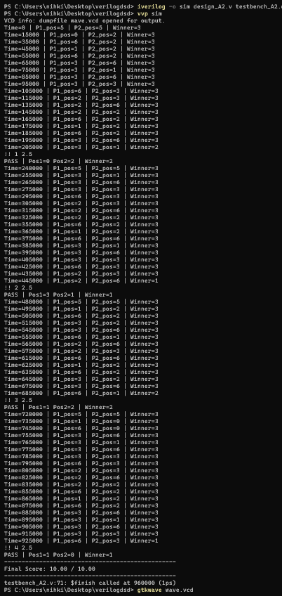

# Simulation Results

The screenshots are arranged in the following order.

## 1. Simulation Commands

## 2. Terminal Output

## 3. GTKWave Waveform

The generated Value Change Dump file is available as [wave.vcd](wave.vcd).
